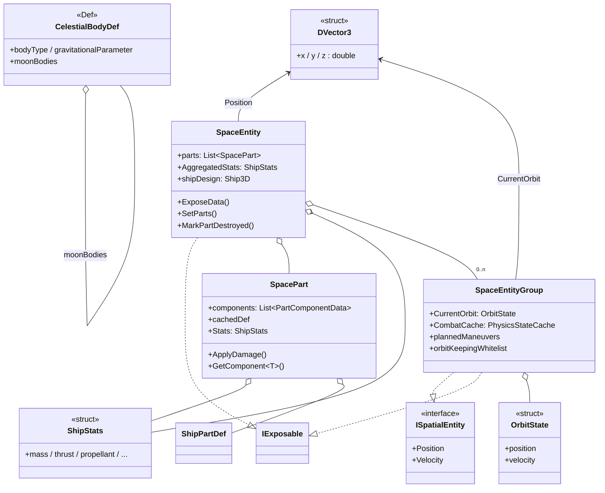
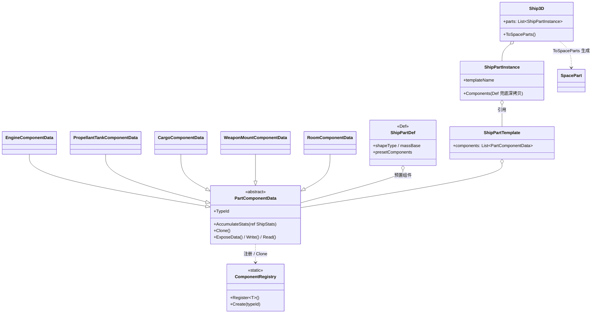
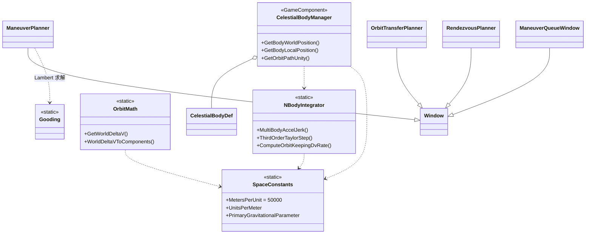
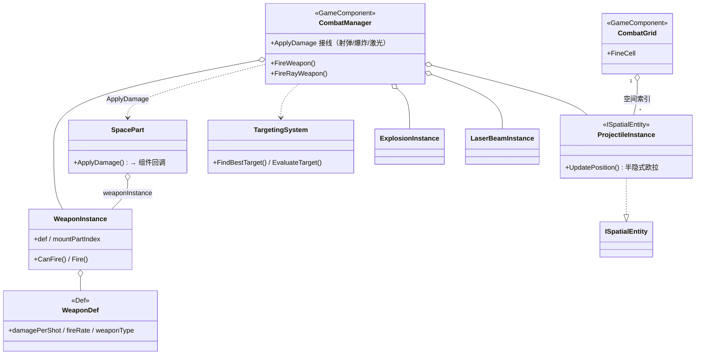
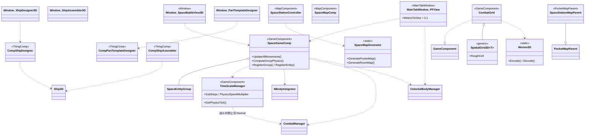

# PioneerFramework 全项目类图

> 生成日期：2026-08-07
> 覆盖范围：全部 132 个公共类型（按域分 5 张图，省略静态/纯工具类的细节，保留继承/组合/依赖关系）
>
> **查看方式**：本文件为 mermaid `classDiagram` 语法，可用以下工具渲染：
> - VS Code：装 "Markdown Preview Mermaid Support" 插件，打开预览
> - Typora（开启动态图）
> - GitHub / GitLab 网页端（自带 mermaid 渲染）
> - 或任意 mermaid 在线渲染器粘贴代码

---

## 图 1：核心数据与实体

## 图 2：组件体系（闭环 1 新增）

## 图 3：轨道物理

## 图 4：战斗系统

## 图 5：装配 / 地图 / 视图 / 中枢

---

## 类图速览（关系统计）

| 关系 | 数量 | 说明 |
|------|------|------|
| `--|>` 继承 | ~25 | 主要继承 RimWorld 框架（GameComponent / Window / Def / ThingComp / GenStep / MapComponent） |
| `..|>` 实现 | ~8 | IExposable / ISpatialEntity / IDisposable |
| `o--` 组合/聚合 | ~20 | 实体↔部件、部件↔组件、管理器↔实体 |
| `..>` 依赖 | ~30 | 静态工具类（NBodyIntegrator / OrbitMath / SpaceMapGenerator）被各层调用 |

**核心枢纽类（改前必查引用）**：`SpaceGameComp`（中枢）、`SpaceEntity`（存档+实体）、`CombatManager`（战斗）、`SpacePart`（部件枢纽）、`PartComponentData`（组件基类）。
